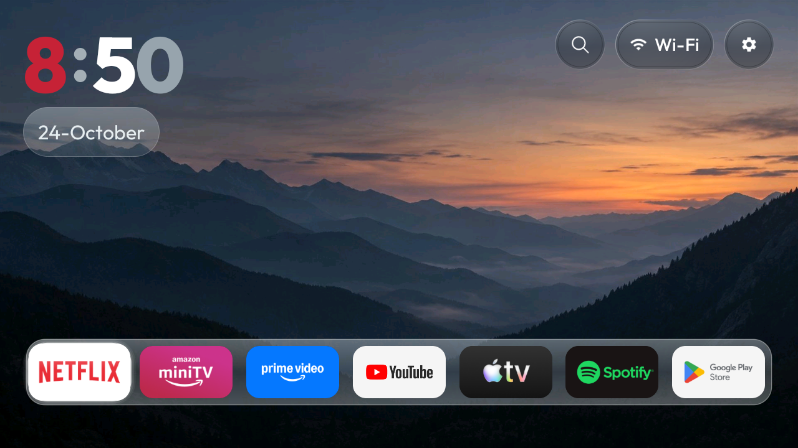
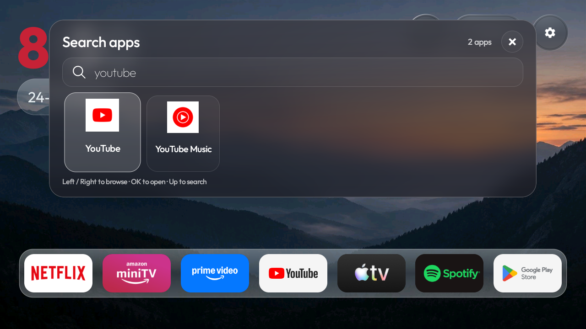

# Redmi Glass Launcher

A custom Android TV launcher based on [Gathin23's cleanyourtv](https://github.com/Gathin23/cleanyourtv).
Tested on **Redmi MiTV-AXFR0, Android TV 11**. Requires Android 8.0 or newer;
other models and Android versions have not been tested here.

| Mountain Glass Home | App search |
|---|---|
|  |  |

Both screenshots come from the signed 3.12.1 launcher on the real TV.

## Features

- Mountain wallpaper, coloured clock, date pill and compact seven-app glass dock.
- Frosted offline app search with icons and remote navigation.
- App grid, App Library and remote app/dock ordering.
- Selectable classic app-colour look, with separate ordering for each look.
- Optional Play Next and cached-process cleanup. **Both are off by default.**

## Download and install

[**Download version 3.12.1**](https://github.com/harshsingh0930/tv-vibehack/releases/tag/v3.12.1)

| APK | Purpose |
|---|---|
| **`redmi-glass-3.12.1.apk`** | Full launcher; can become default Home. This is the normal download. |
| `redmi-glass-preview-3.12.1.apk` | Try the design; cannot become Home and skips process cleanup. |

Install **one** APK. Both can coexist with upstream and older personal builds.
Preferences are separate and are not copied between apps.

- **Phone or USB:** download the APK, transfer it to the TV and open it with a TV file manager. A phone-only wireless ADB option is also documented.
- **Computer:** `adb -s YOUR_SERIAL install -r redmi-glass-3.12.1.apk`.
- Open **Redmi Glass Launcher** from the TV app list. Choose default Home in TV settings if wanted. Android may reset its Home selection to a chooser after installation; keep your previous launcher installed.

[Installation steps, phone tools and checksums](docs/INSTALL.md).
The upstream Clean Your TV phone app installs its own launcher, not this fork.
Our APK is a separate install; no debloating is required.

The downloaded APK file can be deleted after installation. If you tried the
preview first, uninstall **Mountain Glass Preview** from TV Settings > Apps when
finished. Installing the full launcher does not remove the preview automatically.

## Remote controls

| Action | Control |
|---|---|
| Select/open an app | D-pad, then OK |
| Browse the app grid | Down from the dock |
| Search | Select Search; OK in the field to type, Down for results, Back to close |
| Change theme or enable Play Next | **Hold OK on the gear > Launcher options** |
| Move an app or edit the dock | Hold OK on its tile |
| Open Inputs in Mountain Glass | Hold OK on Search |

To use Play Next later, enable **Show Play Next** in Launcher options. Apps must
publish watch progress for entries to appear; otherwise the row shows an empty
message. The [install guide](docs/INSTALL.md) includes the optional TV-listings
permission command if your TV requires it.

## Build and validation

Use JDK 17 and Android SDK 34 / build-tools 34.0.0:

```powershell
.\launcher\build.ps1 -JavaHome 'C:\Java\jdk-17' -SdkPath 'C:\Android\Sdk'
```

macOS/Linux: `cd launcher`, then `./gradlew assembleDebug`.
Output: `launcher/app/build/outputs/apk/debug/app-debug.apk`.
[Build and data-use details](docs/CUSTOM-FORK.md).

Both signed APKs installed and launched on the test TV. Checks covered dock
navigation, search and app launch/return, theme switching and the Play Next empty
state. All 11 JVM tests pass. Lint: zero errors, 44 warnings; the old target-SDK
Play policy finding remains a warning for this sideload release (target API 29).
Phone-only installation and changing the 12/24-hour setting are not tested end-to-end.

Search and wallpaper work offline. Play Next artwork may be fetched over HTTPS
from addresses supplied by installed apps. No analytics or launcher account.
The release uses its own signing key; local debug builds cannot update a signed
release in place. Package IDs and checksums are in the install guide.

## Credits

Original launcher/tools: [Gathin23 and contributors](https://github.com/Gathin23/cleanyourtv).
Code: [MIT](LICENSE). Outfit: [SIL OFL](launcher/FONT-LICENSE-OFL.txt).
Wallpaper: [provenance](themes/mountain-glass/CREDITS.md).
My smaller App Library contribution was merged in [PR #305](https://github.com/Gathin23/cleanyourtv/pull/305).
The [personal branch](https://github.com/harshsingh0930/tv-vibehack/tree/custom/tv-home) is separate.

---

<details>
<summary>Original project README (historical guide)</summary>

Retained from the fork's starting point (`19f3c22`). Use the instructions above
for this launcher; see [cleanyourtv](https://github.com/Gathin23/cleanyourtv) for
the original author's current guide.


# tv-vibehack

**Your TV, minus the ads.** Debloat any Android TV / Google TV over ADB and give it a clean,
tvOS-inspired launcher. Hand the prompt to Claude Code or any coding assistant, answer a few
questions about which apps you use, and it does the rest on the real TV.

| Stock home screen | After |
|---|---|
|  |  |

Everything is reversible: packages are disabled, never uninstalled, and a restore script puts the
stock launcher back.

## Quick start

1. On the TV: Settings → Device Preferences → About → press OK on **Build** seven times → back →
   Developer options → turn on **USB debugging** (and Network/ADB debugging if your TV shows it).
   Keep the TV on and on the same Wi-Fi as your computer.
2. Open Claude Code (or your assistant of choice) on your computer and paste the prompt from
   [`PROMPT.md`](PROMPT.md), filling in your TV model.
3. Accept the "Allow USB debugging?" prompt on the TV when told to, then answer the checklist
   questions (which apps you use, which four go in the dock).

That's it. The assistant backs up, debloats, builds and installs the launcher, and verifies each
step with screenshots from the TV. If you'd rather do it by hand, the pieces are below.

## What's in the repo

| Path | What it is |
|---|---|
| [`PROMPT.md`](PROMPT.md) | The prompt. Brand-neutral; the assistant discovers your TV's bloat. |
| [`launcher/`](launcher/) | The tvOS-style launcher. Edit `app/src/main/res/values/config.xml` for your dock, hidden apps and Live TV package, then run `build-and-install.sh`. |
| [`tools/tv.py`](tools/tv.py) | Pure-Python ADB client (shell, batch, push, pull). Works where the stock `adb` is blocked. |
| [`tools/b64push.py`](tools/b64push.py) | Uploads larger files (APKs) as base64 chunks with an md5 check. |
| [`tools/disable.sh`](tools/disable.sh), [`tools/restore.sh`](tools/restore.sh) | Apply or undo a debloat list. |
| [`examples/`](examples/) | Per-TV debloat lists. Add yours, see [CONTRIBUTING.md](CONTRIBUTING.md). |

## The launcher

A small native Android TV home screen (`com.gathin.tvhome`), built for sets with 1 GB of RAM:

- Pitch-black background, like Apple TV 4K.
- A dock at the bottom in a lighter rounded band with the four apps you choose. The shelf above
  shows the focused dock app's name in large type with an ambient glow sampled from its banner.
  Press Down and the dock slides up to reveal the rest of your apps in a grid.
- One translucent glass highlight springs from tile to tile. The focused tile lifts and shows its
  name.
- Frosted pills top right: **Inputs** (a dropdown of HDMI ports, AV and Live TV), **Wi-Fi**
  (shows the network name) and **Settings**. Greeting, a large thin clock and the date top left,
  set in [Outfit](https://fonts.google.com/specimen/Outfit).
- Deterministic D-pad navigation, last focused tile remembered, staggered entrance animation.
  No blur, no video, no network, no background services.

Configure it in [`launcher/app/src/main/res/values/config.xml`](launcher/app/src/main/res/values/config.xml):
dock order, hidden apps, Live TV package and columns. Build and install with

```bash
TV_HOST=192.168.1.50 launcher/build-and-install.sh
```

Needs JDK 17 and the Android SDK (platform 34, build-tools 34.0.0). On macOS:
`brew install openjdk@17 android-commandlinetools && sdkmanager "platforms;android-34" "build-tools;34.0.0"`.

## Talking to the TV by hand

```bash
python3 -m venv tools/venv && tools/venv/bin/pip install -r tools/requirements.txt
export TV_HOST=192.168.1.50                                   # your TV's IP
tools/venv/bin/python -I tools/tv.py --probe                 # model, Android version, firmware
tools/venv/bin/python -I tools/tv.py 'pm list packages'      # one command
printf 'cmd1\ncmd2\n' | tools/venv/bin/python -I tools/tv.py --batch
tools/disable.sh examples/xiaomi-mi-tv-4a/debloat.txt        # apply a list
tools/restore.sh examples/xiaomi-mi-tv-4a/debloat.txt        # undo it, restore stock launcher
```

### Gotchas we hit

- **macOS: `adb connect` says "No route to host"** while the port is clearly open. Recent macOS
  treats the Google-signed `adb` as its own app under Local Network privacy and silently blocks it.
  `tools/tv.py` avoids the binary entirely.
- **No "wireless debugging" toggle** on some TVs (Xiaomi among them). USB debugging alone opens
  network ADB on port 5555.
- **Chained `pm` commands** (`pm disable a; pm disable b`) may silently stop after the first. Run
  one per shell call; `--batch` does this.
- **Large pushes hang** through the Python client. Use `tools/b64push.py` for APKs.
- **Disable the stock launcher only after the new one is installed**, or the Home button lands on
  a factory test app.
- **Third-party launchers** often charge for basics like a custom wallpaper. Hence `launcher/`.
- **No on-screen keyboard** after switching launchers (seen on Xiaomi): the default input method
  pointed at a Baidu IME that isn't installed. Fix with
  `tools/tv.py 'ime set com.google.android.inputmethod.latin/com.android.inputmethod.latin.LatinIME'`.

## Supported TVs

Anything running Android TV or Google TV: Xiaomi/Redmi, TCL, Hisense, Sony, OnePlus, Realme,
Nvidia Shield and most others. Not Samsung Tizen, LG webOS or Amazon Fire TV (different OS, no ADB
launcher replacement). Tested so far on the models in [`examples/`](examples/).

## Contributing

Add your TV's debloat list, improve the launcher, or sharpen the prompt. See
[CONTRIBUTING.md](CONTRIBUTING.md).

## Licence

MIT, see [`LICENSE`](LICENSE). The Outfit typeface is under the SIL Open Font License, see
`launcher/FONT-LICENSE-OFL.txt`.

</details>
