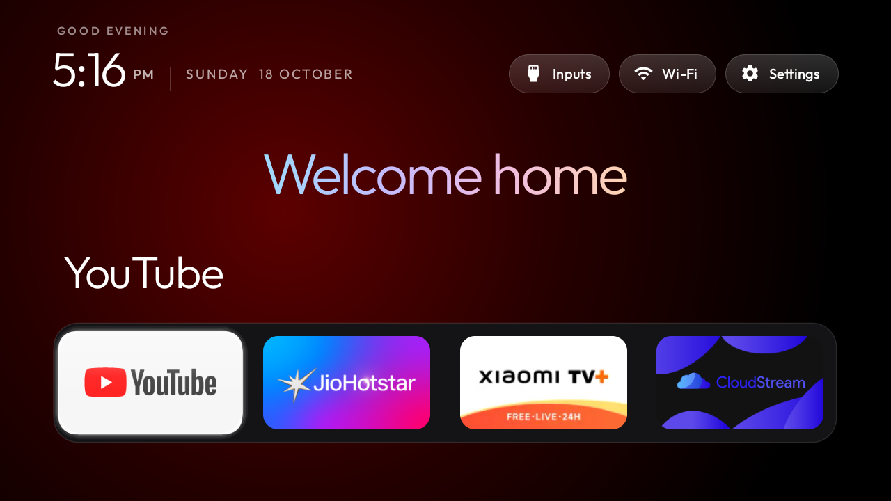
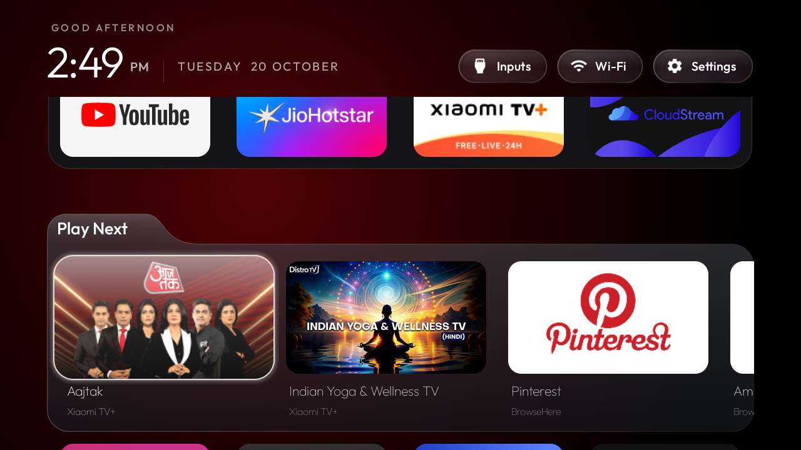

# Redmi glass launcher

Public Home-screen fork on `main`, version 3.12.1. Based on Gathin23's launcher, with
Play Next, remote app and dock editing, a horizontal App library, glass controls,
artwork-matched background colours and a finite Welcome home word animation.
The upstream reference launcher has a deliberately smaller scope. It now also
has app reordering and an installed-app library, including my merged PR #305.
This branch retains its own frosted presentation and Play Next integration;
not every capability listed above is exclusive to it. Code remains MIT licensed, with the
original Outfit font licence in `launcher/FONT-LICENSE-OFL.txt`.

[Mountain Glass](../themes/mountain-glass/README.md) adds the reference-inspired
wallpaper, clock, date pill, search and seven-slot glass dock to the public
edition. Hold OK on Settings to switch to the classic look; the two looks keep
separate dock and app-order preferences. The original screenshots below show
the classic look. Mountain Glass Home, dock navigation and filtered glass search were checked on the real TV; see the current screenshots in the root README.

## Build and install

Use JDK 17, Android SDK platform 34 and build-tools 34.0.0. Set `JAVA_HOME`
and `ANDROID_HOME`, then build from this branch:

```powershell
.\launcher\build.ps1 -JavaHome 'C:\Java\jdk-17' -SdkPath 'C:\Android\Sdk'
```

On macOS/Linux, run `cd launcher && ./gradlew assembleDebug` with the same
environment variables. Gradle downloads the pinned dependencies on first use.
The APK is `launcher/app/build/outputs/apk/debug/app-debug.apk`.

For a manually configured TV, use its exact ADB serial:

```sh
adb -s YOUR_SERIAL install -r launcher/app/build/outputs/apk/debug/app-debug.apk
adb -s YOUR_SERIAL shell pm grant com.harshsingh.redmiglass android.permission.READ_TV_LISTINGS
```

These commands install the app and grant access to Play Next entries. They do
not disable other packages or switch the default Home. The install helper now also
leaves those choices to you. The published app ID is `com.harshsingh.redmiglass`;
it installs alongside upstream and older personal builds. Its Java namespace
remains `com.gathin.tvhome`. The preview ID is `com.harshsingh.redmiglass.preview`.
The release uses its own signing key. A local debug build cannot update a signed
release in place; use the same signing key for updates. Separate packages do not
import preferences from the old launcher.

The example dock, hidden-app and tuner defaults in `config.xml` match the tested
Redmi configuration. Change them for another TV. Saved Home choices override
those defaults. Dock and grid order, Home visibility and cleanup settings can
be changed with the remote; neither removing a shortcut nor editing the dock
uninstalls an app.

## Permissions and data use

Play Next reads resume links, progress and artwork URIs that installed apps
publish to Android's TV provider. Those apps decide which entries are available.
The launcher does not read streaming account credentials or scrape watch history.
Artwork is fetched on demand from the HTTPS address in a published entry, with
timeouts, response-size limits and a 2 MiB bitmap cache. Local content URIs are
resolved through Android. The source in `WatchNextRow.java` documents the loader.

Wi-Fi permissions let the header show network status and the current network
name. Location permission is used for the SSID on supported Android versions;
this launcher has no GPS lookup, location upload, analytics or account system.

Home cleanup is off by default in 3.12.1. When enabled it requests that Android close eligible cached processes.
It does not force-stop apps or guarantee extra free RAM. Music, VPN, downloads,
casting and protected system packages are excluded; active services can remain.
Android 14 and later restrict this API, so the launcher skips these requests
there. Hold OK on Settings for the cleanup switch.

## Hardware and validation

The Home features were developed and tested on Redmi MiTV-AXFR0, Android 11/API 30,
firmware `RTT0.210630.002.2318 release-keys`. This is a device-specific fork, not a
claim of support for every Android TV. It preserves the original spring within
app rows and uses a separate bounded tracker for the scrolling Play Next shelf.
Horizontal row changes end the previous highlight and begin it at the next tile.
A held Up press stops at the dock until released. The welcome animation finishes
behind translucent TV Settings and hides in the lower app grid.

The public source builds independently of the personal development checkout.
Release and preview builds and all 11 JVM tests pass for 3.12.1. Android lint
reports no errors; the old target-SDK Play policy finding is explicitly retained
as a warning for this sideload-only release. Minimum API is 26, target API is 29.
The release banner/icon now use proper PNG encoding, TV app-list launch is present,
and Java font-weight calls are guarded on Android 8.

The signed 3.12.1 preview installed successfully on retry after an initial verifier
rejection. No verification setting was changed. Dock edges, filtered search,
result navigation, empty results, popup dismissal, classic/Mountain Glass switching
and the optional Play Next empty state were exercised on the real TV.
Android 8 and newer Android versions were not tested on hardware. Generated APKs,
local SDK paths and signing keys stay out of Git.



