# Occasion Studio screenshots

Captured on 24 October 2026 from the current production website build, running locally with an isolated demo account. The backdrop is original code-drawn demo artwork; no private uploads, real pairing codes or account credentials are shown. The app tiles in website previews are illustrative. Static captures show a moment of each animation.

## Website

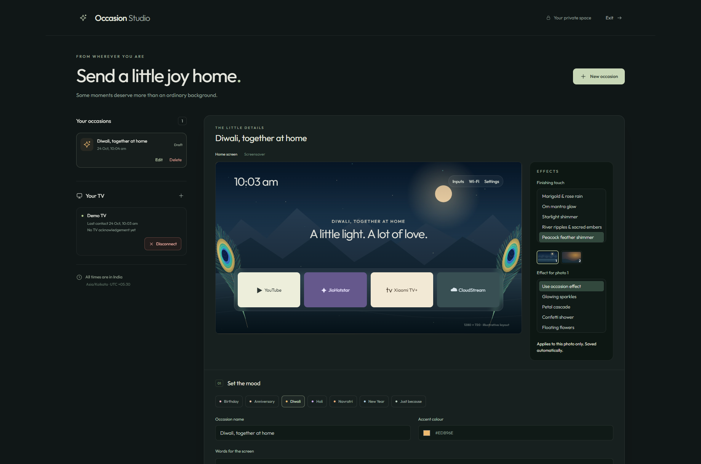

| Mobile editor | Per-photo controls |
|---|---|
| 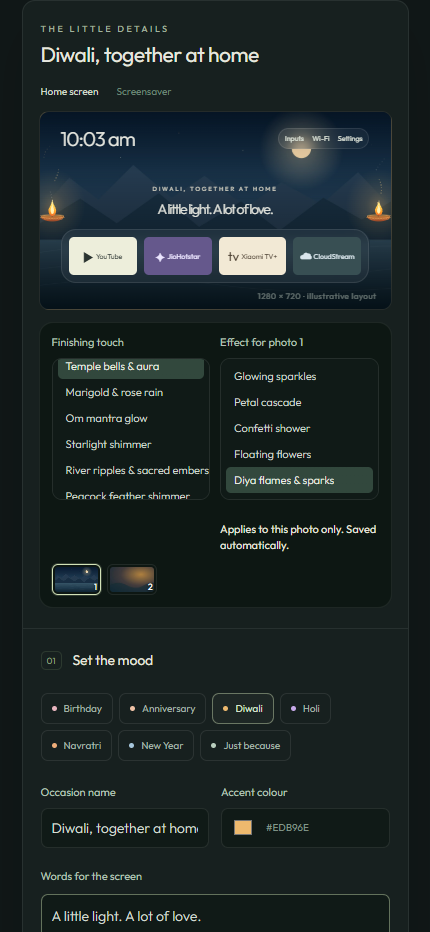 | 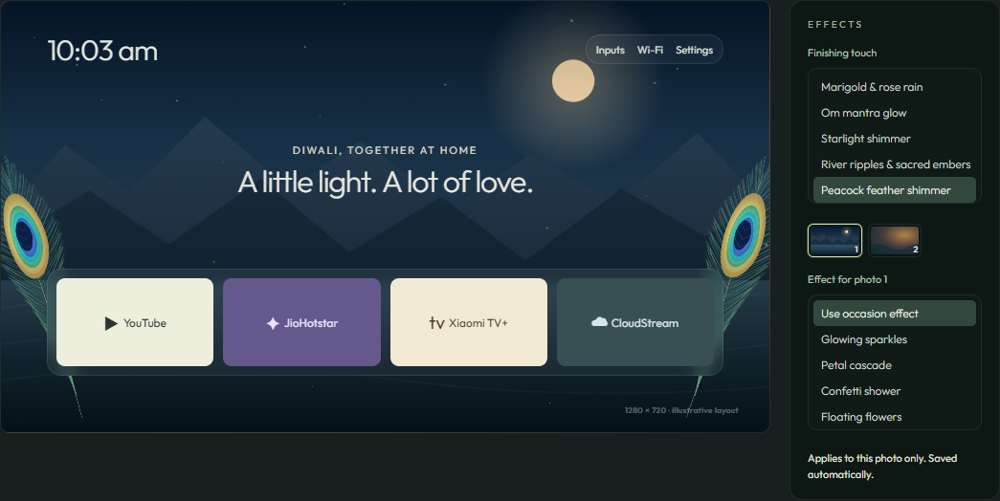 |

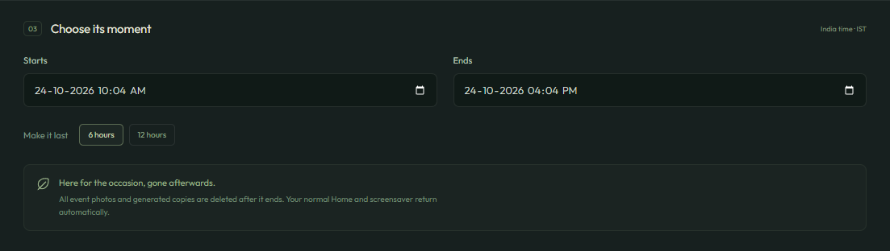

## Effects

All 13 animated effects were freshly captured and checked for changing frames and visible artwork above the Home dock. No effects clears the overlay. These are browser previews, not TV screenshots or standalone add-on tests.

| Effect preview | Effect preview |
|---|---|
| **Glowing sparkles** | **Petal cascade** |
| 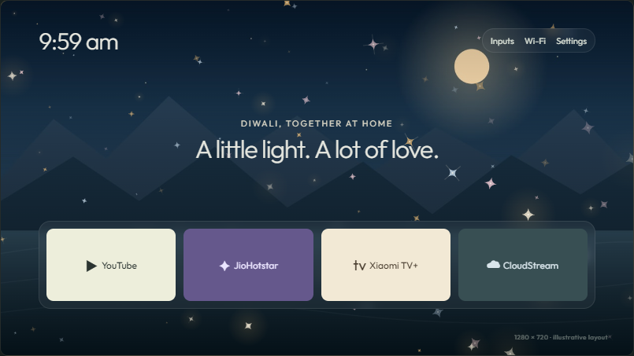 | 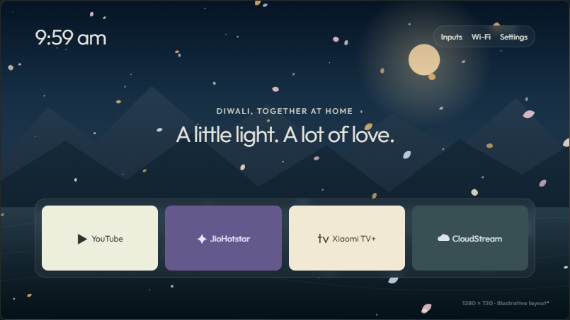 |
| **Confetti shower** | **Floating flowers** |
|  | 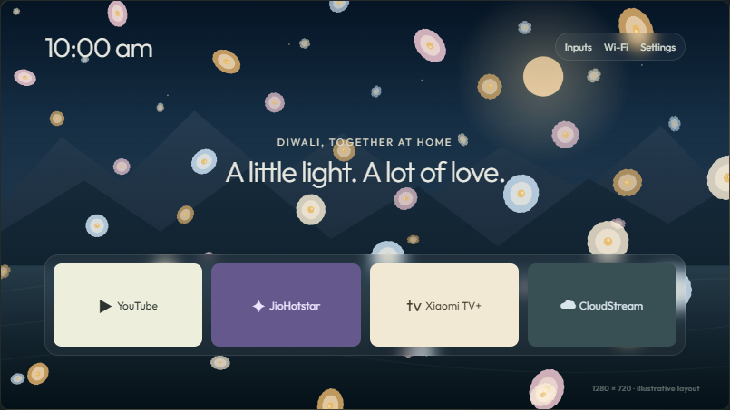 |
| **Diya flames & sparks** | **Holi gulal drift** |
| 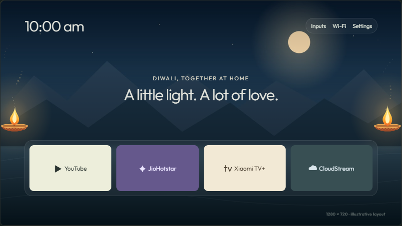 | 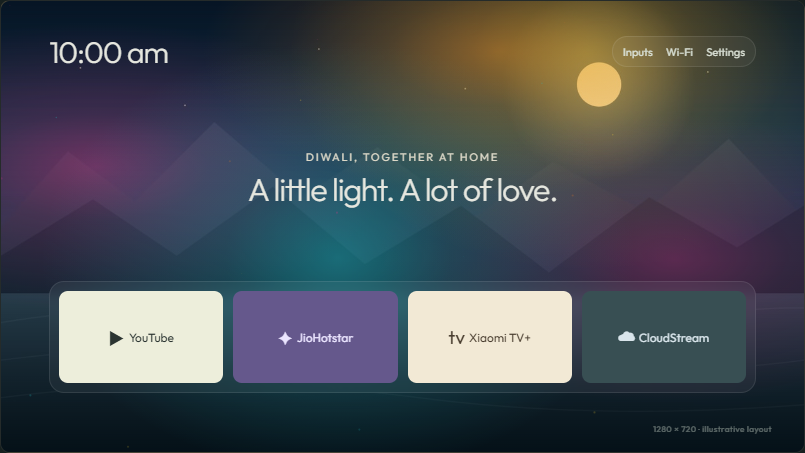 |
| **Temple bells & aura** | **Marigold & rose rain** |
| 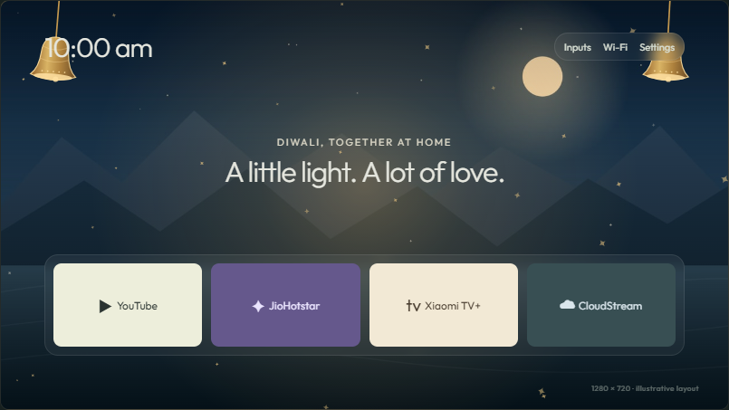 | 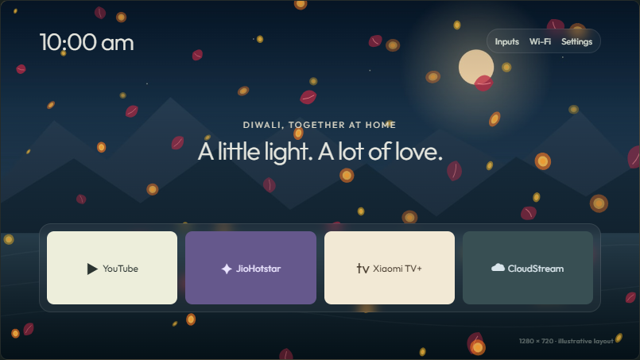 |
| **Om mantra glow** | **Starlight shimmer** |
| 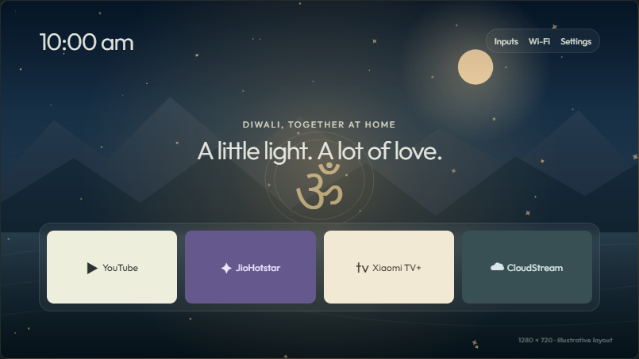 | 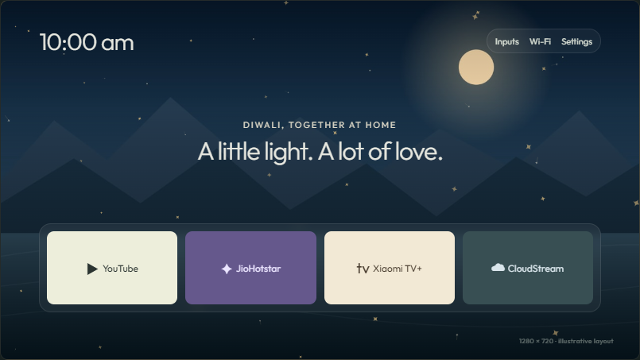 |
| **River ripples & sacred embers** | **Peacock feather shimmer** |
|  | 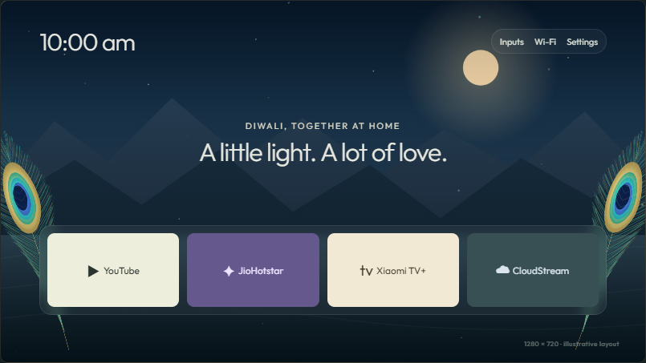 |
| **Golden peepal leaf drift** | **No effects** |
| 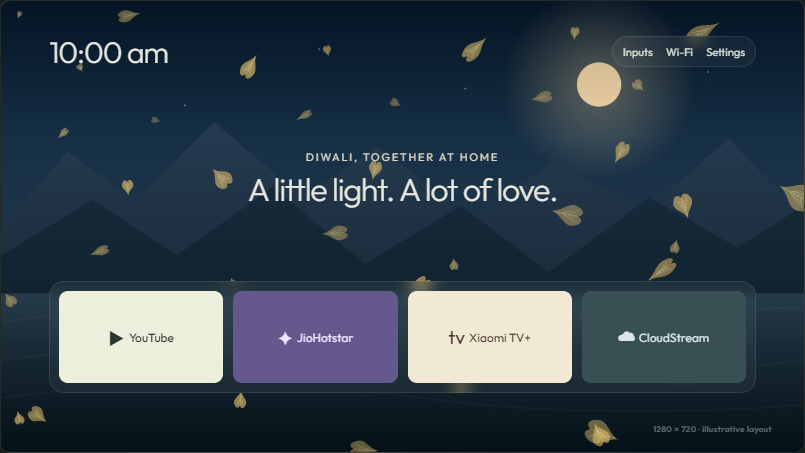 |  |

## Screensaver preview

The browser's screensaver preview uses the same selected photo and effect, without the illustrative app dock.

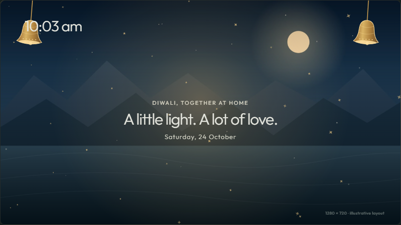

## Real TV

These two existing, unedited captures show the integrated personal launcher on a Redmi MiTV-AXFR0, Android TV 11. The text is from the offline-schedule test. The native effect source matches the published personal branch. No new TV access was used to prepare this gallery.

| Peacock on Home | Diyas on Home |
|---|---|
| 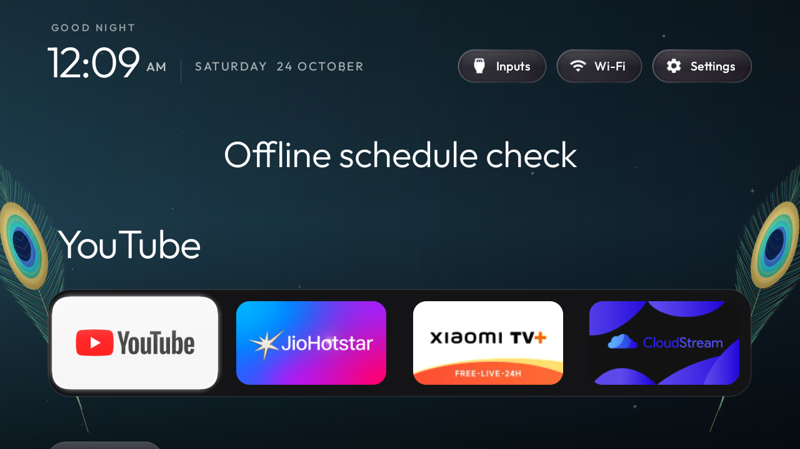 | 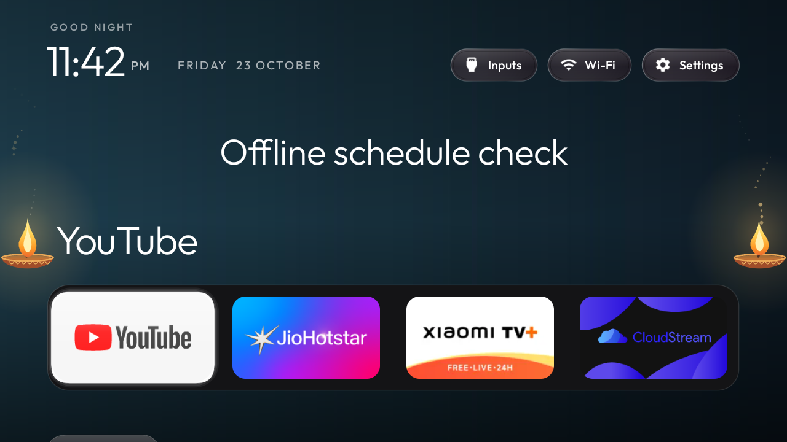 |

The standalone add-on is a proposal and has not been built or tested. [Setup and features](../../README.md).
